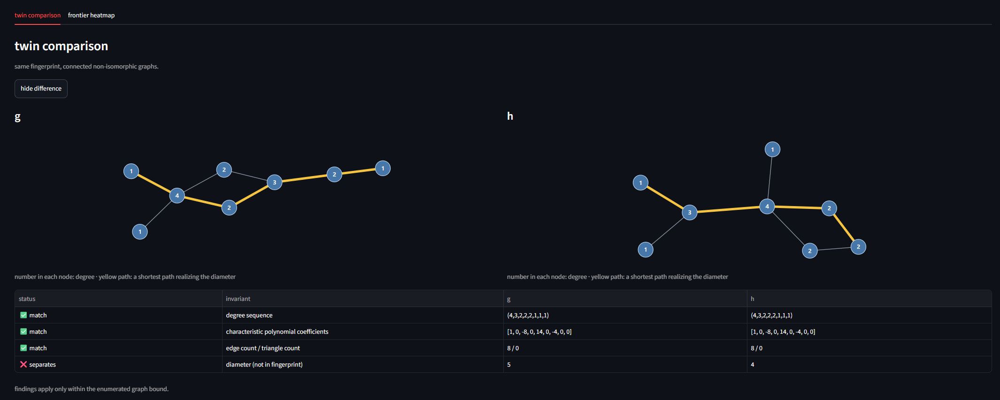
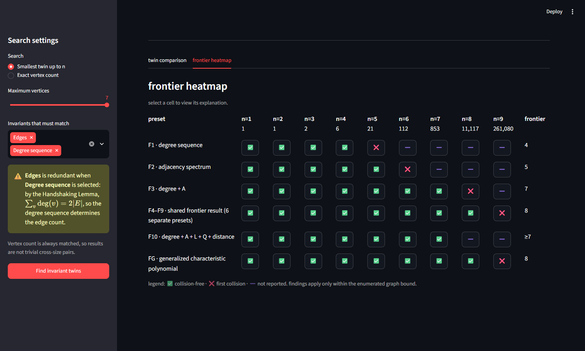

# Invariant Twins

[](https://github.com/denizguneey/invariant-twins/actions/workflows/tests.yml) [](pyproject.toml) [](LICENSE)

An interactive, exact-arithmetic laboratory for finite graph-invariant fingerprints and reproducible non-isomorphic witnesses.

Birincil arayüz: React + FastAPI web uygulaması. Yeni geliştirme bu arayüzü hedefler.

Streamlit uygulaması **Legacy arayüz** olarak korunur; henüz silinmemiştir.

Can a few numerical properties of a graph uniquely identify it? If not, what is the first pair of different graphs that those properties confuse?


## Birincil web uygulaması (React + FastAPI)

```bash
python -m venv .venv
# Windows: .venv\Scripts\activate
# macOS/Linux: source .venv/bin/activate
python -m pip install -e ".[test]"
cd web/frontend
npm install
npm run test
npm run build

cd ../..
python -m invariant_twins.web
```

Ardından `http://127.0.0.1:8000` adresini açın. Geliştirme sırasında Vite
sunucusu için `npm run dev`, Python testleri için
`python -m pytest -q` kullanılır.

## Legacy arayüz (Streamlit)

```bash
streamlit run app.py
```

## What it does

- Selects exact invariant families and searches finite connected-graph domains for collisions.
- Uses integer characteristic-polynomial coefficients rather than rounded eigenvalues.
- Checks witness pairs with NetworkX isomorphism.
- Shows deterministic SVG graphs and graph6 witnesses.
- Computes a finite Fingerprint Frontier with exhaustive-count checks.

## Identify My Graph

The runtime domain is intentionally split: `n ≤ 7` uses the NetworkX Graph
Atlas, while `n = 8` uses McKay's complete connected catalogue through an
Invariant Twins-generated, verified local SQLite invariant index.  McKay
supplies graph structures; invariant values are computed by this project
offline.  Web requests never generate a missing n=8 index.

`Identify My Graph` starts with a connected five-vertex example that you can edit as a simple undirected graph. Select supported exact invariants to see the complete same-order collision class in the Graph Atlas, receive a deterministic best-next-invariant recommendation, and compute a minimum identifying set for that one graph.

This is different from *Explore Twins*: the former asks which supported invariants identify one chosen graph among the finite comparison domain, while the latter asks where a fingerprint first confuses non-isomorphic graphs. Both are finite computational results, not claims about arbitrary graph orders.

Fingerprint Frontier is the largest graph order exhaustively verified collision-free before the first non-isomorphic fingerprint collision. It is a finite computational notion.

## Example: two graphs the fingerprint cannot tell apart

`G = G?AFBo` and <code>H = G?B@&#96;w</code> are connected graphs with 8 vertices, 8 edges, and triangle count 0. They have the same degree sequence `(4,3,2,2,2,1,1,1)` and exact adjacency characteristic-polynomial coefficients `[1, 0, -8, 0, 14, 0, -4, 0, 0]`, yet `nx.is_isomorphic(G, H)` is false. Their diameters are `G = 5` and `H = 4`. Same fingerprint does not mean same graph.



## Results (finite domain)

| Fingerprint | Verified outcome | Frontier |
| --- | --- | ---: |
| F1 degree sequence | first collision at n=5 | 4 |
| F2 adjacency spectrum | first collision at n=6 | 5 |
| F3 degree + adjacency spectrum | first collision at n=8 | 7 |
| F4–F9 A/L/Q combinations | first collision at n=9; 261,080 graphs examined | 8 |
| F10 degree + A + L + Q + distance | collision-free through n=7; beyond not reported | ≥7 |
| FG generalized characteristic polynomial | collision-free through n=8; first collision at n=9; 261,080 graphs examined | 8 |

The Frontier heatmap uses ✅ for exhaustively collision-free, ❌ for first collision, and ➖ for not reported; color is not the only signal. All outcomes are finite computational results for the enumerated domain, not universal graph-theoretic theorems.



## Related work

This project reproduces and explores finite spectral-graph phenomena with exact arithmetic and verifiable witnesses; it does not claim a new theorem.

- C. D. Godsil and B. D. McKay, *Some computational results on the spectra of graphs*, Combinatorial Mathematics IV, Springer LNM 560 (1976), 73–92. Relevant to computational spectral results through order 9.
- W. H. Haemers and E. Spence, *Enumeration of cospectral graphs*, European Journal of Combinatorics 25 (2004), 199–211. [DOI](https://doi.org/10.1016/S0195-6698(03)00100-8). Relevant to cospectral enumeration at orders 10 and 11.
- A. E. Brouwer and E. Spence, *Cospectral Graphs on 12 Vertices*, The Electronic Journal of Combinatorics 16(1) (2009), #N20. [DOI](https://doi.org/10.37236/258). Relevant to higher-order cospectral enumeration.
- C. Abiad and C. A. Alfaro, *Enumeration of cospectral and coinvariant graphs*, Applied Mathematics and Computation 408 (2021); [arXiv:2008.05786](https://arxiv.org/abs/2008.05786). Relevant to enumeration methodology.
- M. Aouchiche and P. Hansen, *Cospectrality of graphs with respect to distance matrices*, Applied Mathematics and Computation 325 (2018), 309–321. [DOI](https://doi.org/10.1016/j.amc.2017.12.025). Relevant to distance spectra.
- A. D. Bessa, I. C. Rocha-Neto, S. T. R. de Pinho, R. F. S. Andrade, and T. C. Petit Lobao, *Graph Cospectrality using Neighborhood Matrices*, The Electronic Journal of Combinatorics 19(3) (2012), #P23. [DOI](https://doi.org/10.37236/2617). Relevant to combining matrix-based graph information.
- Yu Chen and Haiyan Chen, *The characteristic polynomial of a generalized join graph*, Applied Mathematics and Computation 348 (2019), 456–464. [DOI](https://doi.org/10.1016/j.amc.2018.12.013). Relevant to the generalized characteristic-polynomial convention used here.
- G. Rattan and T. Seppelt, *Weisfeiler–Leman and graph spectra*, SODA 2023; [arXiv:2103.02972](https://arxiv.org/abs/2103.02972). Relevant to spectral invariants and Weisfeiler–Leman.
- [OEIS A001349](https://oeis.org/A001349). Connected unlabeled graph counts used for exhaustive-count checks.

## Reproducing results

For orders `n <= 7` the project uses the NetworkX Graph Atlas; for larger exhaustive searches it uses nauty/geng to enumerate connected unlabeled graphs. Run `python scripts/run_frontier.py --preset F6 --max-order 7` for the Atlas stage. Manual GitHub Actions workflows install nauty and validate graph counts before larger runs. Independently verify a collision record with `python scripts/verify_witness.py <result.json>`.

See [reproduction notes](docs/reproducing-results.md), [deployment notes](docs/deploying.md), [mathematical background](docs/background.md), [research metadata](research/README.md), [CITATION.cff](CITATION.cff), and [MIT License](LICENSE).

## Limitations and structure

The repository does not claim novelty or a theorem. Results apply only to their stated finite search bounds. Reusable code is in `src/invariant_twins/`; command-line tools are in `scripts/`; compact verified metadata is in `research/`.

## Tests

Run `python -m pytest -q`.
